# Experimental results

Generated 2026-10-13 06:35 on `Linux-7.0.0-34-generic-x86_64-with-glibc2.39`. 10 seeds per setting unless stated. Time unit: ms. Unless marked *hardware*, all results are **simulation** evidence.

## E1 - Baseline comparison

300 tasks, 4 cores, offered load 0.9, medium mix, 30 % of tasks with soft deadlines, context switch 0.05 ms, 10 seeds. Cells: mean [95 % CI]. Each seed's workload was fingerprinted and verified identical for all algorithms (10 distinct workloads, one per seed).

### Task-level metrics

| Algorithm | Avg waiting (ms) | Avg response (ms) | Avg turnaround (ms) | p95 waiting (ms) | Max waiting (ms) | Avg slowdown |
|---|---|---|---|---|---|---|
| FCFS | 45.05 [20.40, 69.70] | 45.05 [20.40, 69.70] | 65.23 [40.10, 90.35] | 112.16 [69.63, 154.69] | 136.10 [87.19, 185.01] | 15.69 [8.18, 23.20] |
| SJF | 15.07 [10.63, 19.51] | 15.07 [10.63, 19.51] | 35.24 [30.15, 40.34] | 65.85 [46.19, 85.51] | 364.14 [188.91, 539.37] | 2.70 [2.34, 3.06] |
| SRTF | 9.15 [6.64, 11.66] | 3.28 [1.90, 4.65] | 29.33 [26.23, 32.42] | 35.69 [27.87, 43.50] | 528.06 [320.32, 735.80] | 1.14 [1.12, 1.16] |
| RR(q=10) | 29.65 [15.58, 43.72] | 11.20 [6.09, 16.31] | 49.82 [35.36, 64.29] | 104.62 [64.22, 145.03] | 371.88 [169.81, 573.95] | 5.14 [3.32, 6.96] |
| Priority | 47.12 [21.28, 72.97] | 47.12 [21.28, 72.97] | 67.29 [40.82, 93.76] | 262.19 [114.31, 410.06] | 403.66 [231.73, 575.59] | 16.71 [8.84, 24.57] |
| Adaptive | 16.43 [5.22, 27.63] | 13.29 [2.25, 24.33] | 36.60 [25.05, 48.16] | 77.02 [29.26, 124.79] | 245.51 [213.47, 277.54] | 2.34 [1.17, 3.51] |

### Percentiles

| Algorithm | p50 W | p90 W | p95 W | p99 W | p50 R | p95 R |
|---|---|---|---|---|---|---|
| FCFS | 41.56 [12.06, 71.06] | 99.20 [59.62, 138.78] | 112.16 [69.63, 154.69] | 129.55 [81.06, 178.04] | 41.56 [12.06, 71.06] | 112.16 [69.63, 154.69] |
| SJF | 4.09 [2.94, 5.25] | 35.82 [26.50, 45.14] | 65.85 [46.19, 85.51] | 163.17 [105.81, 220.53] | 4.09 [2.94, 5.25] | 65.85 [46.19, 85.51] |
| SRTF | 0.05 [0.05, 0.05] | 13.27 [10.69, 15.86] | 35.69 [27.87, 43.50] | 203.78 [131.03, 276.53] | 0.05 [0.05, 0.05] | 12.78 [8.32, 17.24] |
| RR(q=10) | 15.59 [7.10, 24.08] | 71.59 [41.64, 101.53] | 104.62 [64.22, 145.03] | 213.49 [118.95, 308.04] | 10.54 [3.93, 17.16] | 28.12 [21.08, 35.16] |
| Priority | 7.36 [4.65, 10.08] | 178.23 [62.71, 293.76] | 262.19 [114.31, 410.06] | 368.22 [191.23, 545.22] | 7.36 [4.65, 10.08] | 262.19 [114.31, 410.06] |
| Adaptive | 3.26 [1.31, 5.21] | 47.10 [6.34, 87.85] | 77.02 [29.26, 124.79] | 165.70 [115.38, 216.02] | 2.89 [0.97, 4.81] | 61.19 [12.12, 110.27] |

### System metrics

| Algorithm | CPU utilisation | Throughput (tasks/s) | Idle fraction | Context switches | Scheduler overhead (ms) |
|---|---|---|---|---|---|
| FCFS | 0.87 [0.84, 0.90] | 174.01 [162.40, 185.62] | 0.13 [0.10, 0.15] | 300.00 [300.00, 300.00] | 0.21 [0.16, 0.26] |
| SJF | 0.87 [0.84, 0.89] | 172.64 [160.94, 184.34] | 0.13 [0.11, 0.16] | 300.00 [300.00, 300.00] | 0.16 [0.14, 0.18] |
| SRTF | 0.85 [0.82, 0.88] | 170.30 [158.09, 182.50] | 0.14 [0.11, 0.17] | 477.10 [462.76, 491.44] | 1.39 [1.22, 1.56] |
| RR(q=10) | 0.87 [0.84, 0.90] | 172.99 [161.25, 184.74] | 0.13 [0.10, 0.16] | 661.10 [610.30, 711.90] | 0.38 [0.31, 0.46] |
| Priority | 0.87 [0.84, 0.90] | 173.48 [161.47, 185.50] | 0.13 [0.10, 0.16] | 300.00 [300.00, 300.00] | 0.25 [0.18, 0.32] |
| Adaptive | 0.86 [0.83, 0.89] | 171.97 [160.06, 183.89] | 0.14 [0.10, 0.17] | 404.50 [397.19, 411.81] | 7.04 [4.44, 9.63] |

### Fairness and starvation summary

| Algorithm | Jain fairness | Starved tasks | Max W / mean B | W prio 1-2 (ms) | W prio 4-5 (ms) | Deadline miss rate |
|---|---|---|---|---|---|---|
| FCFS | 0.603 [0.513, 0.693] | 5.600 [-7.068, 18.268] | 6.716 [4.376, 9.056] | 44.027 [20.671, 67.382] | 46.604 [20.267, 72.941] | 0.381 [0.231, 0.530] |
| SJF | 0.830 [0.808, 0.851] | 2.200 [0.738, 3.662] | 17.677 [9.620, 25.733] | 16.706 [9.495, 23.918] | 13.941 [11.154, 16.729] | 0.051 [0.029, 0.074] |
| SRTF | 0.977 [0.973, 0.981] | 2.900 [1.532, 4.268] | 26.121 [15.873, 36.370] | 11.012 [5.144, 16.880] | 8.814 [6.733, 10.894] | 0.008 [0.001, 0.014] |
| RR(q=10) | 0.720 [0.646, 0.793] | 5.200 [0.044, 10.356] | 17.899 [8.715, 27.082] | 31.217 [14.673, 47.761] | 29.299 [16.438, 42.160] | 0.211 [0.073, 0.348] |
| Priority | 0.705 [0.658, 0.753] | 20.000 [4.761, 35.239] | 19.484 [11.991, 26.976] | 6.946 [5.299, 8.593] | 99.820 [40.478, 159.162] | 0.231 [0.157, 0.305] |
| Adaptive | 0.870 [0.813, 0.927] | 4.900 [-1.276, 11.076] | 12.211 [10.580, 13.842] | 13.531 [4.459, 22.603] | 19.851 [6.015, 33.688] | 0.053 [-0.026, 0.131] |

### Adaptive vs each baseline (paired over seeds)

Positive % = Adaptive better. Δ = Adaptive − baseline with 95 % CI; p = Wilcoxon signed-rank.

| Adaptive vs | Avg W | Avg R | Max W | Jain | Miss rate |
|---|---|---|---|---|---|
| FCFS | **+63.5 %** (Δ -28.62 [-42.79, -14.46], p=0.002) | **+70.5 %** (Δ -31.76 [-46.16, -17.36], p=0.002) | **-80.4 %** (Δ +109.41 [+74.57, +144.24], p=0.002) | **+44.2 %** (Δ +0.27 [+0.22, +0.31], p=0.002) | **+86.2 %** (Δ -0.33 [-0.43, -0.22], p=0.002) |
| SJF | **-9.0 %** (Δ +1.36 [-6.47, +9.19], p=0.105) | **+11.8 %** (Δ -1.78 [-9.51, +5.95], p=0.084) | **+32.6 %** (Δ -118.64 [-274.59, +37.32], p=0.131) | **+4.9 %** (Δ +0.04 [-0.01, +0.09], p=0.084) | **-2.7 %** (Δ +0.00 [-0.07, +0.07], p=0.160) |
| SRTF | **-79.5 %** (Δ +7.28 [-1.74, +16.29], p=0.002) | **-305.7 %** (Δ +10.02 [+0.20, +19.84], p=0.002) | **+53.5 %** (Δ -282.55 [-468.31, -96.79], p=0.002) | **-10.9 %** (Δ -0.11 [-0.16, -0.05], p=0.002) | **-594.3 %** (Δ +0.05 [-0.03, +0.12], p=0.039) |
| RR(q=10) | **+44.6 %** (Δ -13.22 [-17.78, -8.66], p=0.002) | **-18.6 %** (Δ +2.09 [-4.27, +8.44], p=0.432) | **+34.0 %** (Δ -126.38 [-308.40, +55.65], p=0.432) | **+20.9 %** (Δ +0.15 [+0.12, +0.18], p=0.002) | **+75.0 %** (Δ -0.16 [-0.23, -0.08], p=0.002) |
| Priority | **+65.1 %** (Δ -30.69 [-46.91, -14.47], p=0.002) | **+71.8 %** (Δ -33.83 [-50.32, -17.34], p=0.002) | **+39.2 %** (Δ -158.16 [-314.66, -1.65], p=0.049) | **+23.4 %** (Δ +0.16 [+0.14, +0.19], p=0.002) | **+77.2 %** (Δ -0.18 [-0.23, -0.12], p=0.002) |

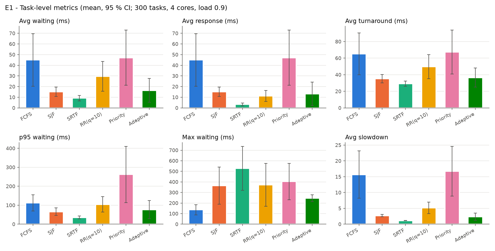
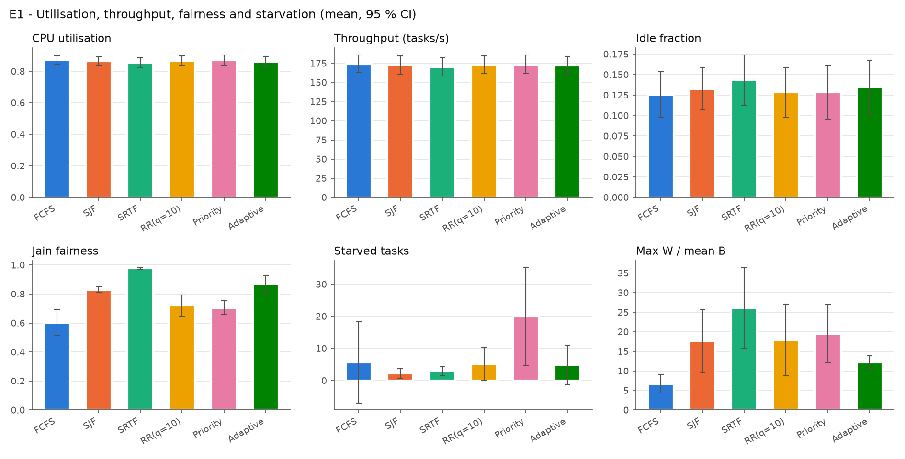
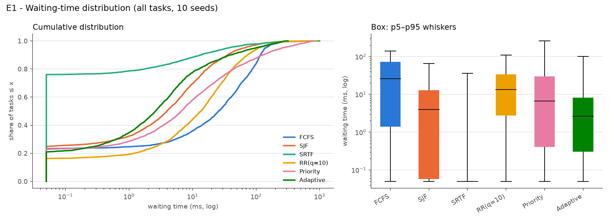

## E2 - Load sweep (congestion and starvation)

### Average waiting (ms)

| load | FCFS | SJF | SRTF | RR(q=10) | Priority | Adaptive |
|---|---|---|---|---|---|---|
| 0.5 | 2.3 | 1.7 | 1.0 | 1.8 | 2.4 | 1.2 |
| 0.6 | 4.5 | 3.0 | 1.7 | 3.5 | 4.7 | 2.1 |
| 0.7 | 9.4 | 5.4 | 3.1 | 7.0 | 11.0 | 3.8 |
| 0.8 | 20.5 | 9.3 | 5.2 | 14.1 | 22.8 | 7.2 |
| 0.9 | 45.1 | 15.1 | 9.2 | 29.6 | 47.1 | 16.4 |
| 1.0 | 82.4 | 22.8 | 14.1 | 54.6 | 87.0 | 36.3 |
| 1.1 | 127.3 | 31.0 | 22.1 | 86.7 | 127.6 | 66.2 |
| 1.2 | 168.3 | 37.2 | 30.9 | 116.4 | 163.6 | 101.5 |

### Maximum waiting (ms)

| load | FCFS | SJF | SRTF | RR(q=10) | Priority | Adaptive |
|---|---|---|---|---|---|---|
| 0.5 | 37 | 49 | 55 | 36 | 71 | 43 |
| 0.6 | 49 | 73 | 99 | 59 | 97 | 78 |
| 0.7 | 65 | 100 | 166 | 114 | 159 | 127 |
| 0.8 | 93 | 178 | 302 | 206 | 264 | 197 |
| 0.9 | 136 | 364 | 528 | 372 | 404 | 246 |
| 1.0 | 189 | 584 | 832 | 555 | 661 | 306 |
| 1.1 | 267 | 923 | 1027 | 742 | 862 | 353 |
| 1.2 | 342 | 1048 | 1079 | 896 | 963 | 388 |

### Deadline miss rate

| load | FCFS | SJF | SRTF | RR(q=10) | Priority | Adaptive |
|---|---|---|---|---|---|---|
| 0.5 | 0.026 | 0.010 | 0.000 | 0.005 | 0.019 | 0.000 |
| 0.6 | 0.047 | 0.009 | 0.000 | 0.011 | 0.044 | 0.001 |
| 0.7 | 0.102 | 0.019 | 0.001 | 0.029 | 0.099 | 0.007 |
| 0.8 | 0.209 | 0.033 | 0.001 | 0.062 | 0.161 | 0.011 |
| 0.9 | 0.381 | 0.051 | 0.008 | 0.211 | 0.231 | 0.053 |
| 1.0 | 0.579 | 0.084 | 0.013 | 0.417 | 0.337 | 0.130 |
| 1.1 | 0.681 | 0.094 | 0.025 | 0.612 | 0.401 | 0.247 |
| 1.2 | 0.731 | 0.101 | 0.042 | 0.705 | 0.454 | 0.361 |

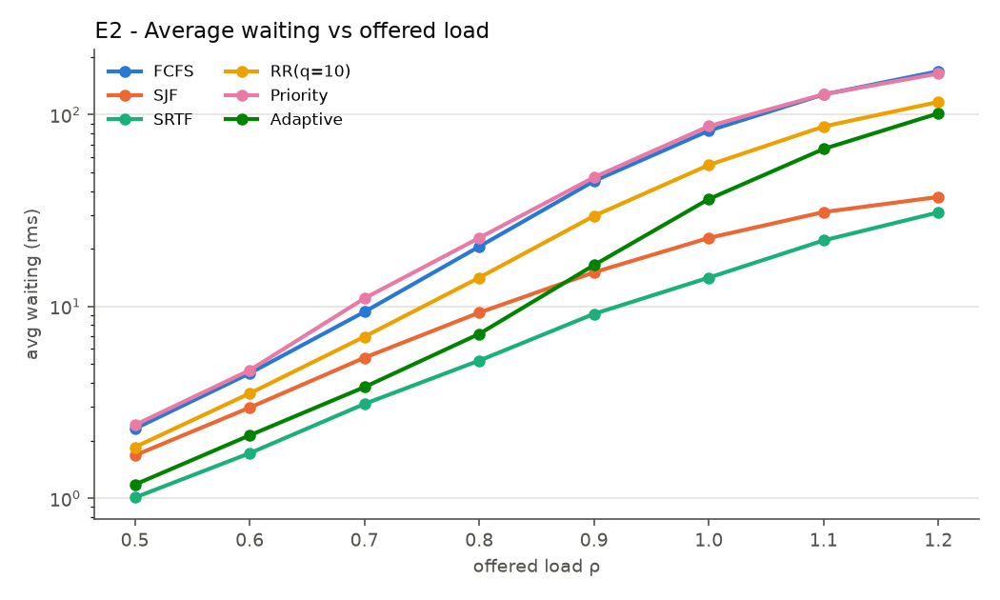
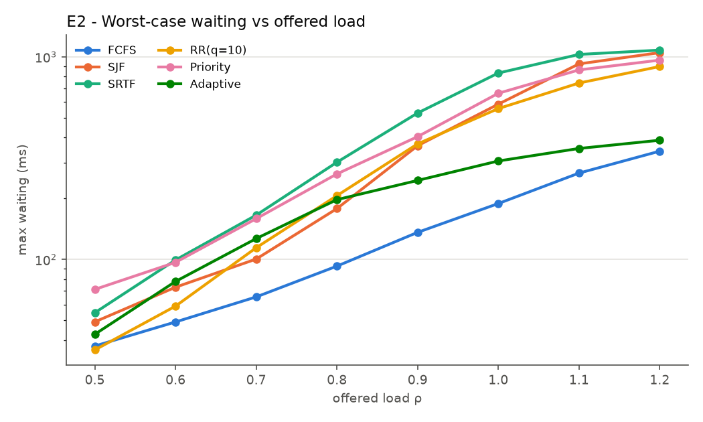
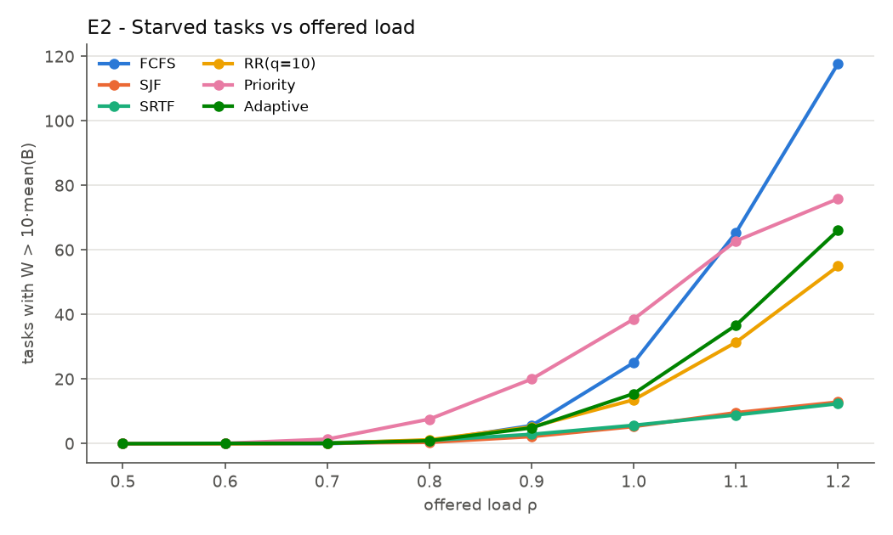
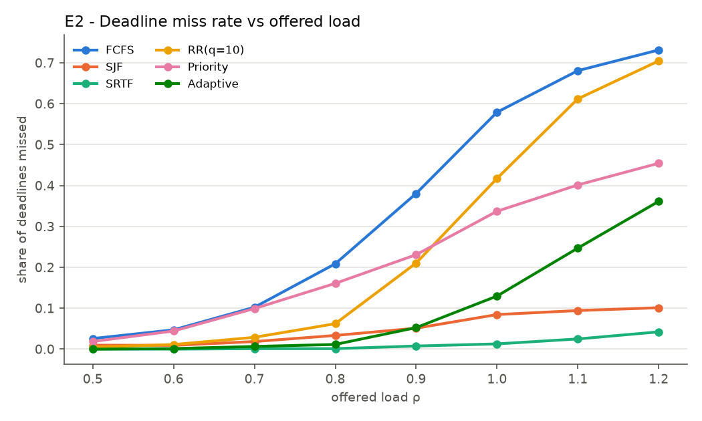

## E3 - Heterogeneity

low = GC + k-mer only; medium = all four categories; high = 30 % alignment. Avg waiting (ms).

| mix | FCFS | SJF | SRTF | RR(q=10) | Priority | Adaptive |
|---|---|---|---|---|---|---|
| low | 18.74 | 7.24 | 5.34 | 16.63 | 17.88 | 7.80 |
| medium | 45.05 | 15.07 | 9.15 | 29.65 | 47.12 | 16.43 |
| high | 48.35 | 17.35 | 10.76 | 31.58 | 47.56 | 16.57 |

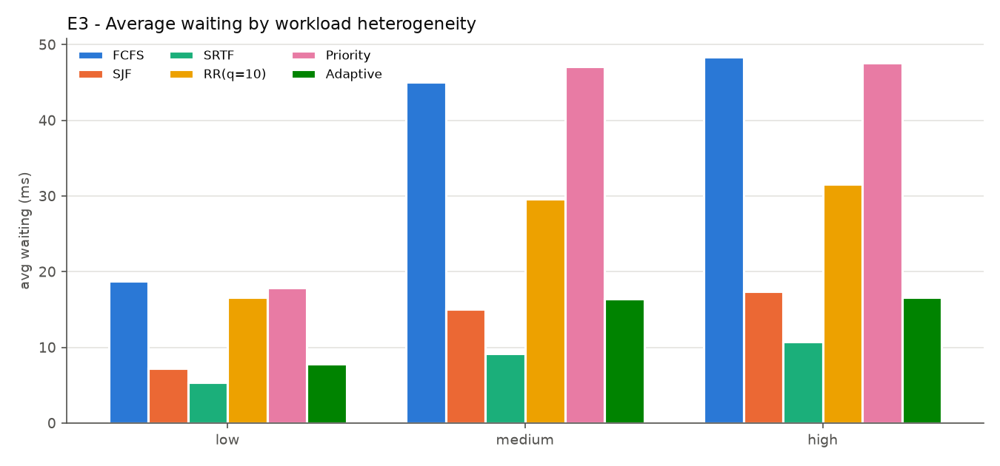

## E4 - Fairness to long alignment tasks

Average waiting (ms) / average slowdown. Size classes on the estimated burst: short < 5 ms ≤ medium < 50 ms ≤ long.

### Per category

| Algorithm | gc_content W / SD | kmer_count W / SD | motif_search W / SD | alignment W / SD |
|---|---|---|---|---|
| FCFS | 44.9 / 39.62 | 45.4 / 7.63 | 44.7 / 4.34 | 45.4 / 2.69 |
| SJF | 4.9 / 4.70 | 10.8 / 1.95 | 15.4 / 1.75 | 44.1 / 1.77 |
| SRTF | 0.1 / 1.05 | 2.1 / 1.07 | 4.8 / 1.13 | 49.7 / 1.47 |
| RR(q=10) | 11.9 / 10.53 | 23.7 / 3.18 | 31.8 / 2.53 | 73.8 / 2.42 |
| Priority | 46.1 / 42.44 | 48.8 / 8.53 | 49.9 / 4.70 | 41.8 / 2.77 |
| Adaptive | 4.2 / 3.48 | 11.5 / 1.90 | 16.6 / 1.73 | 50.7 / 1.83 |

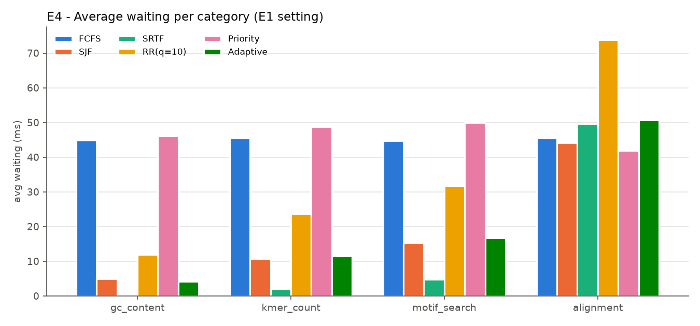
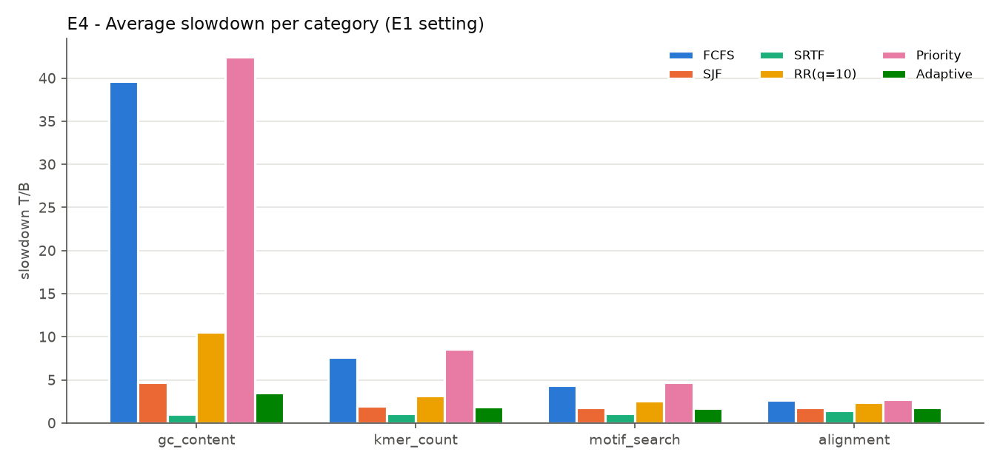

### Per size class

| Algorithm | short W / SD | medium W / SD | long W / SD |
|---|---|---|---|
| FCFS | 44.7 / 42.24 | 45.6 / 4.79 | 42.6 / 1.57 |
| SJF | 4.3 / 4.89 | 13.3 / 1.79 | 72.2 / 1.78 |
| SRTF | 0.1 / 1.05 | 3.1 / 1.10 | 95.7 / 1.84 |
| RR(q=10) | 11.2 / 11.17 | 28.5 / 2.61 | 111.0 / 2.15 |
| Priority | 45.6 / 45.39 | 49.0 / 5.21 | 38.2 / 1.49 |
| Adaptive | 3.1 / 3.57 | 14.4 / 1.80 | 85.2 / 1.94 |

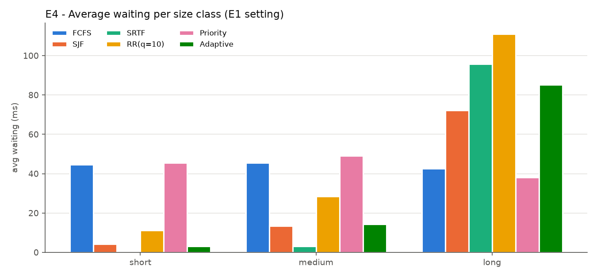
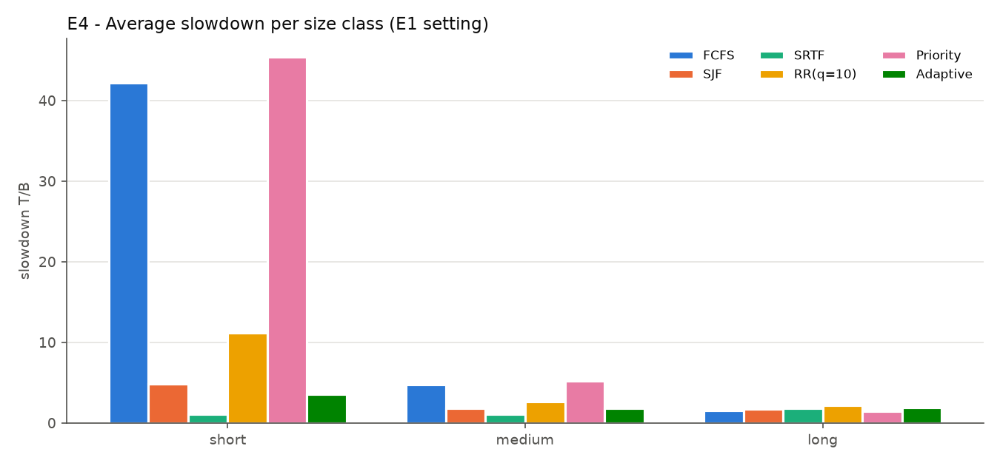

## E5 - Robustness to burst-estimation error

Schedulers only ever see the estimate. Avg waiting (ms).

| estimate_error | FCFS | SJF | SRTF | RR(q=10) | Priority | Adaptive |
|---|---|---|---|---|---|---|
| 0.0 | 27.23 | 11.54 | 7.04 | 20.68 | 28.57 | 8.96 |
| 0.25 | 45.05 | 15.07 | 9.15 | 29.65 | 47.12 | 16.43 |
| 0.5 | 95.53 | 25.81 | 16.08 | 51.71 | 98.57 | 47.41 |
| 1.0 | 360.90 | 92.07 | 86.18 | 159.99 | 355.06 | 283.08 |

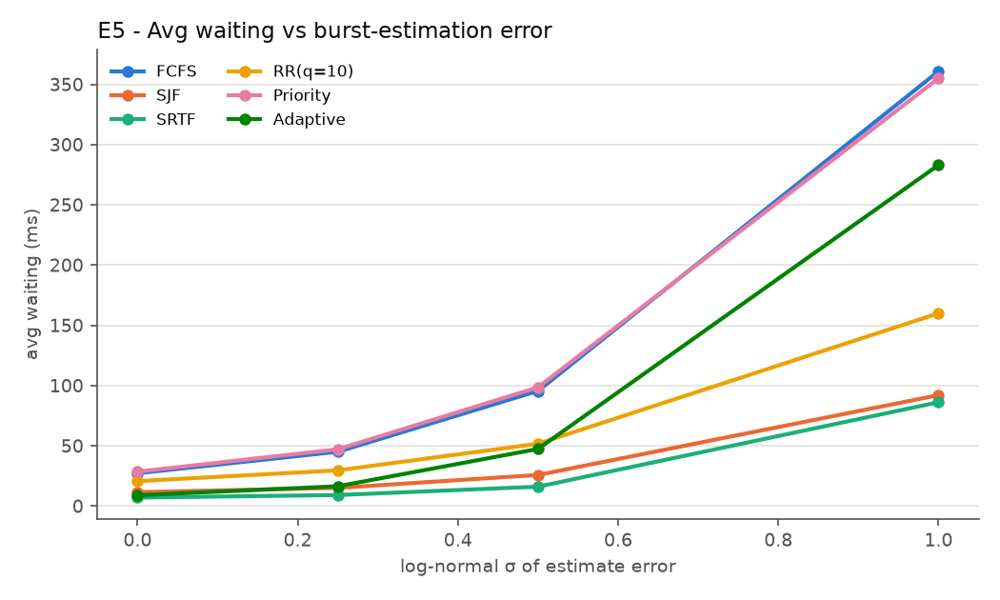

## E6 - Scalability and scheduling overhead

Wall-clock ms spent inside the policy for a whole run (4 seeds).

| tasks | FCFS | SJF | SRTF | RR(q=10) | Priority | Adaptive |
|---|---|---|---|---|---|---|
| 100 | 0.1 | 0.0 | 0.4 | 0.1 | 0.1 | 1.7 |
| 250 | 0.1 | 0.1 | 1.0 | 0.3 | 0.2 | 5.1 |
| 500 | 0.4 | 0.3 | 2.3 | 0.6 | 0.5 | 12.9 |
| 1000 | 0.7 | 0.5 | 4.5 | 1.1 | 0.9 | 39.6 |
| 2000 | 1.8 | 1.2 | 10.5 | 2.8 | 2.3 | 73.5 |

Average waiting (ms) vs cores (500 tasks):

| cores | FCFS | SJF | SRTF | RR(q=10) | Priority | Adaptive |
|---|---|---|---|---|---|---|
| 1 | 289.28 | 85.10 | 43.33 | 180.34 | 294.74 | 242.00 |
| 2 | 132.46 | 38.43 | 20.16 | 83.11 | 138.79 | 81.57 |
| 4 | 59.00 | 18.77 | 10.17 | 37.38 | 62.43 | 21.07 |
| 8 | 22.39 | 8.67 | 4.75 | 14.41 | 23.01 | 6.56 |
| 16 | 6.15 | 2.95 | 1.70 | 4.27 | 5.63 | 2.18 |

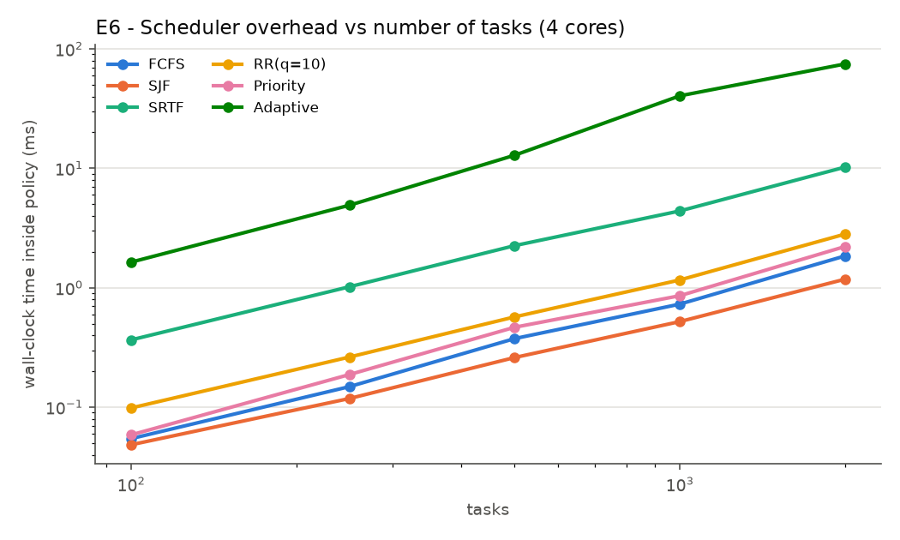
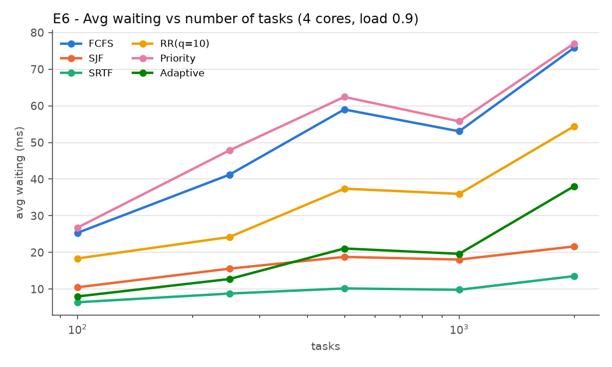
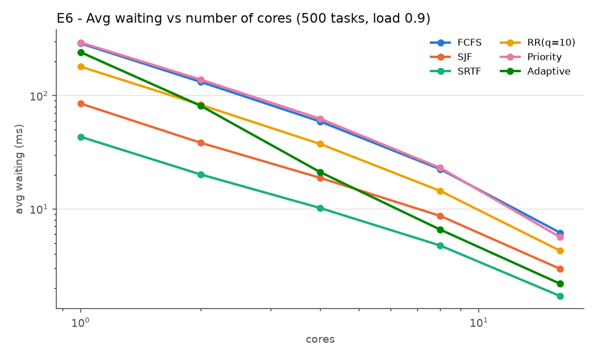
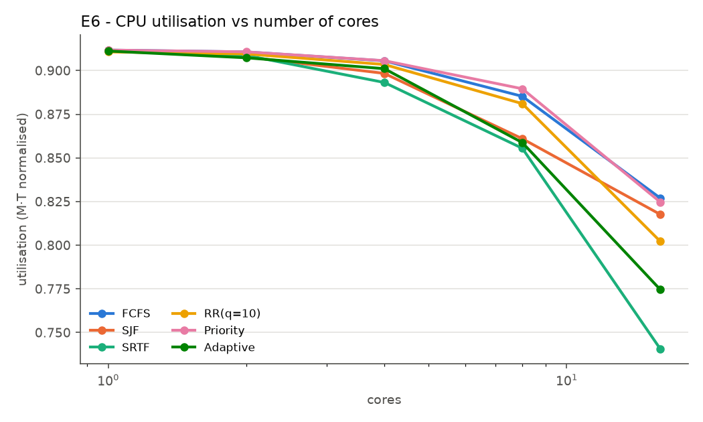

## E7 - Adaptive scheduler sensitivity

Default: weights 0.45 / 0.30 / 0.15 / 0.10 (burst / aging / priority / deadline), aging c = 8, starvation guard θ = 20, q = 10 ms. Each row changes one setting. Mean [95 % CI].

| Algorithm | Avg W | Max W | Avg SD | W prio 1-2 | Miss rate | Guard overrides |
|---|---|---|---|---|---|---|
| default | 16.43 [5.22, 27.63] | 245.51 [213.47, 277.54] | 2.34 [1.17, 3.51] | 13.53 [4.46, 22.60] | 0.05 [-0.03, 0.13] | 0.00 [0.00, 0.00] |
| c=2 | 31.27 [9.72, 52.82] | 136.62 [91.53, 181.71] | 7.56 [1.82, 13.30] | 28.03 [8.05, 48.01] | 0.19 [0.04, 0.33] | 0.00 [0.00, 0.00] |
| c=4 | 23.69 [5.81, 41.57] | 178.02 [141.75, 214.30] | 4.44 [0.51, 8.37] | 19.93 [4.71, 35.15] | 0.09 [-0.01, 0.20] | 0.00 [0.00, 0.00] |
| c=16 | 12.91 [6.95, 18.87] | 330.52 [263.13, 397.90] | 1.76 [1.56, 1.96] | 12.40 [5.33, 19.48] | 0.02 [0.00, 0.04] | 2.40 [-0.62, 5.42] |
| c=32 | 12.50 [7.18, 17.81] | 338.18 [266.76, 409.61] | 1.77 [1.60, 1.95] | 12.36 [5.21, 19.51] | 0.02 [-0.00, 0.03] | 10.00 [-2.71, 22.71] |
| w=.6/.2/.1/.1 | 12.72 [7.05, 18.39] | 337.42 [267.98, 406.86] | 1.78 [1.59, 1.97] | 13.35 [5.60, 21.10] | 0.01 [-0.01, 0.03] | 4.80 [-1.42, 11.02] |
| w=.35/.4/.15/.1 | 22.31 [5.39, 39.23] | 191.62 [156.89, 226.35] | 3.98 [0.49, 7.48] | 17.40 [3.81, 30.99] | 0.08 [-0.02, 0.18] | 0.00 [0.00, 0.00] |
| no deadline term | 16.35 [5.28, 27.42] | 243.77 [209.43, 278.11] | 2.27 [1.34, 3.20] | 13.43 [4.37, 22.48] | 0.06 [-0.02, 0.14] | 0.00 [0.00, 0.00] |
| no priority term | 15.45 [5.59, 25.31] | 256.29 [221.96, 290.63] | 2.13 [1.27, 2.99] | 16.16 [5.26, 27.07] | 0.04 [-0.02, 0.09] | 0.00 [0.00, 0.00] |
| no starvation guard | 16.43 [5.22, 27.63] | 245.51 [213.47, 277.54] | 2.34 [1.17, 3.51] | 13.53 [4.46, 22.60] | 0.05 [-0.03, 0.13] | 0.00 [0.00, 0.00] |
| guard θ=10 | 18.01 [4.17, 31.85] | 209.29 [187.87, 230.72] | 3.03 [0.37, 5.68] | 15.36 [3.23, 27.49] | 0.05 [-0.03, 0.12] | 24.80 [3.59, 46.01] |
| q=5 | 15.80 [4.54, 27.07] | 249.81 [218.09, 281.54] | 2.09 [0.87, 3.32] | 12.74 [3.53, 21.94] | 0.04 [-0.03, 0.11] | 0.00 [0.00, 0.00] |
| q=20 | 17.08 [5.82, 28.33] | 240.73 [208.81, 272.65] | 2.70 [1.54, 3.86] | 14.57 [5.50, 23.64] | 0.05 [-0.01, 0.12] | 0.00 [0.00, 0.00] |
| no quantum | 20.04 [8.52, 31.57] | 221.20 [171.07, 271.32] | 3.45 [2.12, 4.78] | 16.46 [7.21, 25.71] | 0.09 [0.02, 0.16] | 0.00 [0.00, 0.00] |

## E9 - Sequence length

All sequence lengths multiplied by the factor (alignment by its square root per side, so work scales by the factor); arrival rate adjusted to keep load 0.9. Avg waiting (ms).

| length_scale | FCFS | SJF | SRTF | RR(q=10) | Priority | Adaptive |
|---|---|---|---|---|---|---|
| 0.25 | 12.25 | 4.23 | 2.78 | 10.08 | 12.69 | 5.18 |
| 0.5 | 23.18 | 7.91 | 4.91 | 16.87 | 23.80 | 8.99 |
| 1.0 | 45.05 | 15.07 | 9.15 | 29.65 | 47.12 | 16.43 |
| 2.0 | 88.89 | 30.45 | 17.55 | 55.64 | 94.13 | 30.76 |
| 4.0 | 176.52 | 63.82 | 34.55 | 107.52 | 186.29 | 58.64 |

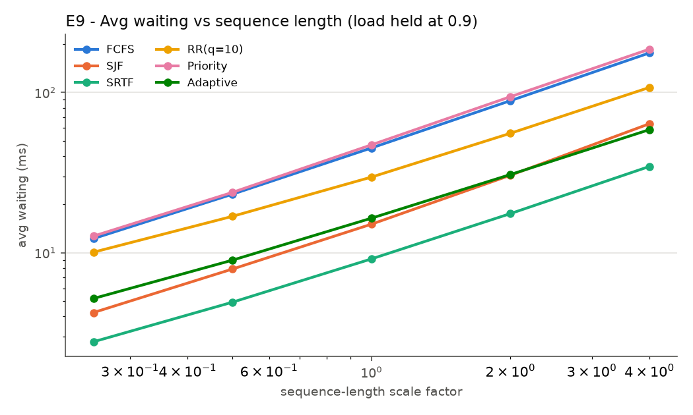

## E8 - Dataset-based workload (measured runtimes)

Input `sample_genome.fa` parsed with Bio.SeqIO: 3/3 records valid, 1,200,000 bases, GC 46.0%. 80 tasks executed on `Linux-7.0.0-34-generic-x86_64-with-glibc2.39` (Python 3.13.5); burst = median of 3 timed runs; estimate = calibrated cost model (R² gc_content 1.00, kmer_count 1.00, motif_search 1.00, alignment 0.98; mean relative estimate error 7%). Hardware monitor during profiling: {'cpu_percent_mean': 5.5, 'cpu_percent_max': 33.3, 'mem_percent_mean': 63.3, 'samples': 80}. Single workload (no CI); timings vary slightly between runs.

| Algorithm | Avg waiting (ms) | Avg response (ms) | Avg turnaround (ms) | p95 waiting (ms) | Max waiting (ms) | Avg slowdown |
|---|---|---|---|---|---|---|
| FCFS | 4.94 | 4.94 | 9.72 | 11.17 | 11.98 | 9.47 |
| SJF | 2.75 | 2.75 | 7.52 | 10.88 | 22.28 | 3.39 |
| SRTF | 1.72 | 0.33 | 6.50 | 10.70 | 45.49 | 1.17 |
| RR(q=10) | 4.53 | 3.77 | 9.30 | 10.82 | 12.91 | 7.48 |
| Priority | 5.07 | 5.07 | 9.84 | 20.98 | 35.12 | 11.01 |
| Adaptive | 2.52 | 1.99 | 7.29 | 9.77 | 19.29 | 2.54 |

## E10 - Hardware validation (real execution)

60 dataset tasks really executed on 4 worker process(es) (one core left for the dispatcher) by a user-space dispatcher that uses the same policy code; 5 repetitions with rotated algorithm order. Non-preemptive policies only (Adaptive-NP = adaptive scoring without quantum). Average waiting (ms), mean [95 % CI]:

| Algorithm | hardware | simulation (profiled bursts) | simulation (replayed bursts) |
|---|---|---|---|
| FCFS | 12.48 [11.11, 13.85] | 4.36 [4.36, 4.36] | 10.38 [9.14, 11.62] |
| SJF | 6.70 [4.96, 8.45] | 2.23 [2.23, 2.23] | 5.12 [3.40, 6.84] |
| Priority | 8.86 [7.07, 10.64] | 2.88 [2.88, 2.88] | 6.50 [5.26, 7.74] |
| Adaptive-NP | 6.86 [5.82, 7.90] | 2.38 [2.38, 2.38] | 5.21 [4.28, 6.15] |

*Hardware* waiting includes inter-process communication latency; *replayed* simulation uses the bursts measured in that hardware run, so the gap between the two is the dispatcher overhead the simulator does not model. These are user-space measurements, not an OS-kernel scheduler.

## Gantt charts, event and decision logs (16 tasks, 2 cores, load 1.5)

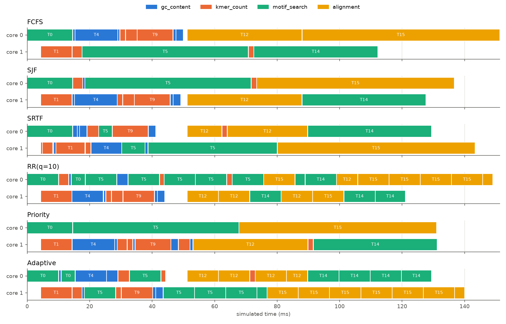

Per-algorithm charts with idle intervals: [FCFS](gantt/gantt_fcfs.png), [SJF](gantt/gantt_sjf.png), [SRTF](gantt/gantt_srtf.png), [RR(q=10)](gantt/gantt_rr_q_10.png), [Priority](gantt/gantt_priority.png), [Adaptive](gantt/gantt_adaptive.png). Event logs (ARRIVE, DISPATCH, PREEMPT, QUANTUM_EXPIRE, COMPLETE, IDLE_START, IDLE_END) are in `gantt/*_events.csv`; `decision_log_adaptive.csv` gives the score breakdown of every Adaptive dispatch decision; `task_log_adaptive.csv` the task-level log.
